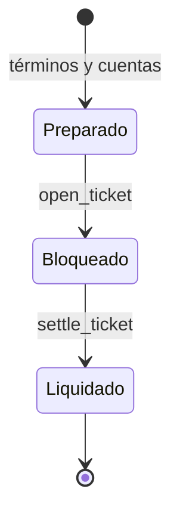

# Arquitectura y flujo de estados

VertexDTL mantiene un ledger local determinista. `AccountState` conserva identidad pública, saldo y nonces; `VertexLedger` administra tickets, transacciones observadas, suministro y journal. La serialización canónica aporta bytes estables a firmas, identificadores y digest de estado. El ejecutable expone escenarios JSON para integradores y pruebas de regresión.

Al abrir, el ledger valida identidad, red, activo, cuentas de destino, política de ruta, nonce y saldo; después debita al pagador y conserva el importe en el ticket. Al liquidar, valida la firma del beneficiario, su nonce y el digest de ruta observado. Finalmente acredita beneficiario y destinatarios de cargos, marca el ticket liquidado y verifica conservación en un estado candidato antes de confirmarlo.

La separación entre dominios de firma de ticket y liberación evita confundir las dos autorizaciones. `RouteAllocation` presenta una cotización aritmética de la distribución; no firma, abre ni liquida tickets.
