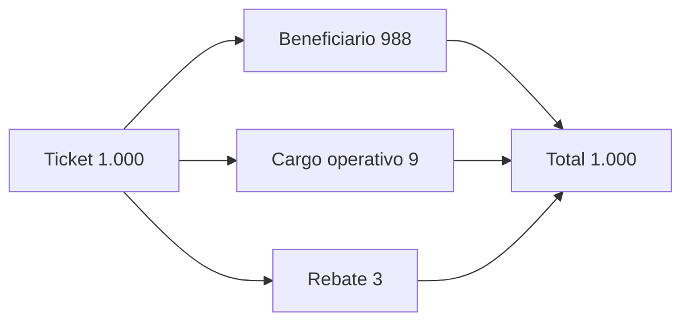

# Modelo económico

El activo se mide con `Amount` en unidades enteras. `Bps` representa puntos básicos entre 0 y 10.000. Las operaciones usan suma y resta verificadas para impedir desbordamiento o importes negativos. El máximo de unidad del ledger se impone antes de admitir importes.

```text
cargos = operator_fee + rebate_amount
neto del beneficiario = importe del ticket − cargos
total distribuido = neto + operator_fee + rebate_amount
suministro = saldos líquidos + importes bloqueados
```

Ejemplo: un ticket de 1.000 unidades con cargo operativo 9 y rebate 3 entrega 988 al beneficiario. El pagador pierde 1.000 al abrir, el ticket conserva 1.000 hasta liquidarse y la distribución vuelve a sumar 1.000. La conservación impide creación de saldo, pero no sustituye las reglas de autorización, identidad y política de cada destino.

La ruta contiene operador, receptor del cargo, receptor opcional de rebate, memo de liquidez y epoch de routing. La política del ticket define venue, techo en bps y epoch de settlement. Los datos de la ruta se verifican en apertura y su digest se compara durante la liberación. Integradores deben mostrar los importes y destinatarios concretos antes de solicitar una firma y volver a comprobar el digest cuando cambia el estado.


