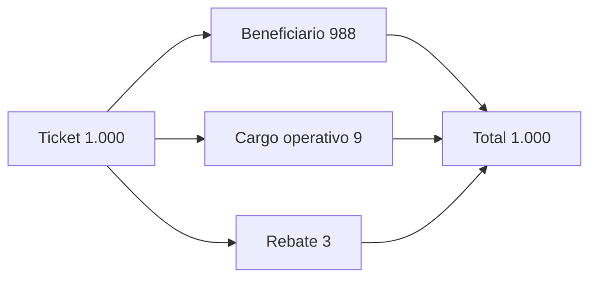
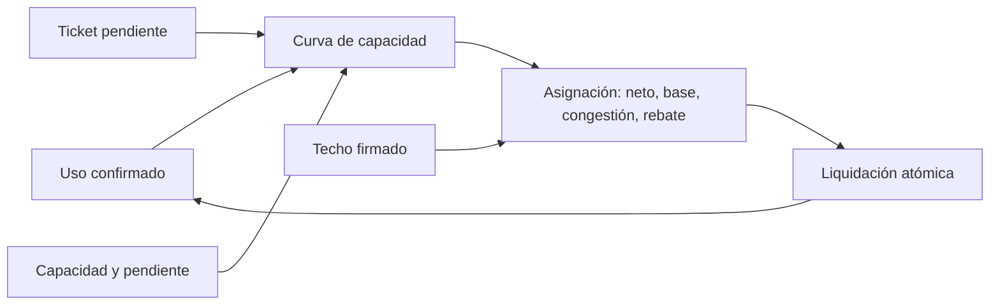

# Modelo económico

El activo se mide con `Amount` en unidades enteras. `Bps` representa puntos básicos entre 0 y 10.000. Las operaciones usan suma y resta verificadas para impedir desbordamiento o importes negativos. El máximo de unidad del ledger se impone antes de admitir importes.

```text
cargos = operator_fee + congestion_surcharge + rebate_amount
neto del beneficiario = importe del ticket − cargos
total distribuido = neto + operator_fee + congestion_surcharge + rebate_amount
suministro = saldos líquidos + importes bloqueados
```

Ejemplo: un ticket de 1.000 unidades con cargo operativo 9 y rebate 3 entrega 988 al beneficiario. El pagador pierde 1.000 al abrir, el ticket conserva 1.000 hasta liquidarse y la distribución vuelve a sumar 1.000. La conservación impide creación de saldo, pero no sustituye las reglas de autorización, identidad y política de cada destino.

La ruta contiene operador, receptor del cargo, receptor opcional de rebate, memo de liquidez y epoch de routing. La política del ticket define venue, techo en bps y epoch de settlement. Los datos de la ruta se verifican en apertura y su digest se compara durante la liberación. Integradores deben mostrar los importes y destinatarios concretos antes de solicitar una firma y volver a comprobar el digest cuando cambia el estado.



## Capacidad y congestión de ruta

Un mercado opcional por operador registra capacidad `C`, volumen liquidado
`U` y pendiente máxima `S` en puntos básicos. Para un ticket de importe `G`,
la cotización calcula `U' = U + G`, exige `U' ≤ C` y publica la utilización
proyectada en bps. La intensidad de la curva aumenta con el cuadrado de la
utilización; el recargo se suma a los cargos fijos y se somete al techo
`G × max_charge_bps / 10.000` firmado por el pagador. El contador `U` solo
avanza cuando el ticket queda liquidado.

| Parámetro | Primer ticket | Segundo ticket |
| --- | ---: | ---: |
| Capacidad `C` | 1.000.000 | 1.000.000 |
| Uso anterior `U` | 0 | 500.000 |
| Bruto `G` | 500.000 | 500.000 |
| Uso proyectado `U'` | 500.000 | 1.000.000 |
| Pendiente `S` | 1.000 bps | 1.000 bps |
| Recargo cotizado | 12.500 | 50.000 |



`RouteAllocation::recomposed_total` suma todas las salidas, incluido el
recargo. La conservación del suministro no certifica por sí sola que una
tarifa comercial sea adecuada; la política y los destinatarios deben
revisarse de forma independiente.
