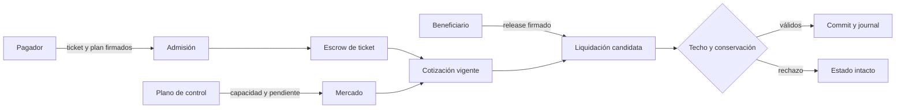

# Riesgo de ruta y controles de integración

Vertex separa tres decisiones: la autorización del pagador sobre términos y
plan de ruta, la autorización del beneficiario para liberar, y la
configuración operativa del mercado de capacidad. La firma no concede permiso
para cambiar una política de operador ni convierte una cotización en una
liquidación irrevocable.

## Controles por frontera

- **Firma:** mostrar red, activo, beneficiario, plan completo, epoch y techo
  antes de solicitar la firma del pagador. Una ruta distinta exige firma nueva.
- **Plano de control:** proteger `configure_route_market` con autenticación y
  autorización externas. Registrar operador, capacidad, pendiente, digest
  anterior y aprobación humana o automatizada correspondiente.
- **Secuenciación:** procesar las liberaciones de un mismo operador en orden
  determinista. La carga confirmada entra en la cotización del ticket siguiente.
- **Cotización:** refrescar `ticket_allocation` inmediatamente antes de
  liquidar. El resultado no bloquea capacidad; otra transición puede cambiarlo.
- **Contabilidad:** cotejar asignación, entradas del journal, saldos de cada
  destinatario, carga acumulada y suministro total en cada lote.

## Respuesta operativa

Si un lote devuelve `Policy`, `InvalidSignature` o `Conservation`, conservar
el envelope original, estado previo, configuración del mercado y orden de
transacciones. No reintentar cambiando silenciosamente la ruta o el techo.
Para reconciliar, reproducir en una instancia aislada con el mismo commit y
comparar digests y saldos. El estado contable equilibrado no sustituye la
revisión comercial de la tarifa o del destinatario.
